# ECS and EKS with GitHub and Jenkins

This repository supports a hands-on workshop I conduct in **Cloud Computing** and **Database Management Systems II**. It follows one small web application from source code in Visual Studio Code, through GitHub review and Jenkins, to deployments on Amazon ECS and Amazon EKS.

The Cloud Computing extension demonstrates deployment recovery, scaling, and a private report in Amazon S3. The steps below follow the workshop guide and include its screenshots. The screenshots show the recorded instructor run; your AWS account, resource IDs, commit hashes, and build numbers will differ.

## Delivery flow

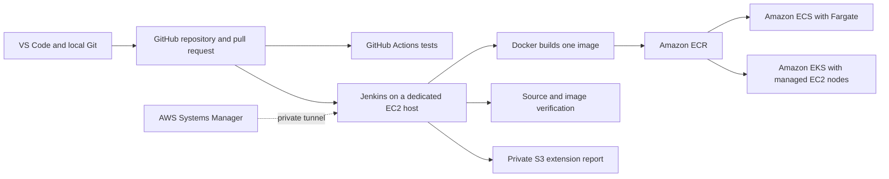

## Step-by-step workshop guide

## 1 Workshop sequence

1. Read the basic concepts below and install the workstation tools before starting the deployment.

2. Extract the workshop package. Open student-starter in VS Code and create your own repository.

3. Build the infrastructure in your own Learner Lab, prepare Jenkins, and deploy version 1.0.0.

4. Implement the comparison feature locally, submit a pull request, and deploy version 2.0.0.

5. Complete the platform comparison. Cloud Computing students also complete the recovery and scaling extension.

## 2 Understand the basic concepts

The application is a small Python web server. It exposes a web page, a health URL, and an API that identifies the release. The cloud platform runs the application inside a container.

| **Term** | **Meaning in this workshop** |
| --- | --- |
| Source code | The Python, HTML and configuration files you edit. |
| Git repository | A local history of changes to those files. |
| GitHub repository | A hosted copy used for sharing, review and automated tests. |
| Commit | A saved change identified by a unique Git hash. |
| Branch | A separate line of work, such as your enhancement. |
| Pull request | A proposal to review and merge a branch into main. |
| CI | Continuous integration: automatically test changes. |
| CD | Continuous delivery or deployment: move an approved release to its runtime. |

**What this step means**

Your computer holds the working files and local Git history. Publishing a branch sends its commits to GitHub. Merging the pull request changes main. Jenkins watches main and deploys its source revision. In this lab, main is the production branch; this is a disposable teaching environment.

## 3 Understand containers and Kubernetes

**Container image and container**

A container image is a packaged application with the runtime and files it needs. A container is a running instance of that image. Think of the image as a saved recipe and the container as one running copy made from it. Containers isolate application processes while sharing the host operating system kernel; they are lighter than a separate virtual machine for each application.

**Docker**

Docker supplies tools to build images and run containers. The Dockerfile in this project describes the application image. Docker Engine runs on the Jenkins EC2 host and builds that image when Jenkins requests it. Students edit the source locally; the cloud host performs the image build, so Docker Desktop is optional for this exercise.

**Kubernetes**

Kubernetes coordinates containers across a group of computers called a cluster. You describe the desired state, such as two healthy copies of a web application, and Kubernetes works to maintain it. The control plane makes management decisions; worker nodes provide the compute that runs the application.

- Pod: the smallest unit Kubernetes schedules. In this lab a pod contains one application container.

- Deployment: manages the desired number of pods and updates them to a new release.

- Service: gives the pods a stable network destination even when individual pods are replaced.

- Namespace: a named area inside a cluster. This project uses workshop to scope application resources and Jenkins access.

- kubectl: a client program on your computer or the Jenkins host that sends requests to a Kubernetes cluster. Installing kubectl does not create a cluster.

## 4 Understand the AWS services and where they run

**Amazon EC2**

Amazon Elastic Compute Cloud provides virtual computers in AWS. This project creates one EC2 host for Jenkins and uses an EKS managed node group containing EC2 worker capacity for the application. These are remote computers; neither is your workstation.

**Amazon ECR**

Amazon Elastic Container Registry is the AWS service that stores container images. GitHub stores the source files; ECR stores the built application image. Jenkins pushes an image into the private csci-container-lab repository, and ECS and EKS retrieve it to run the application. An image digest is a content fingerprint used to verify that both deployments use the same built image.

**Amazon ECS and Fargate**

Amazon Elastic Container Service manages container deployments on AWS. An ECS task definition describes the image and settings; a task is a running copy; a service maintains the desired task count. This lab chooses Fargate compute, so AWS supplies the worker infrastructure and students do not manage an ECS worker EC2 instance.

**Amazon EKS**

Amazon Elastic Kubernetes Service provides Kubernetes on AWS. AWS manages the Kubernetes control plane. In this workshop a managed EC2 node group supplies worker capacity, and a Kubernetes Deployment runs the application pods. You will compare this Kubernetes workflow with the ECS service workflow using the same application image.

**CloudFormation S3 and CloudWatch**

CloudFormation is the AWS infrastructure service that reads infra/lab.yaml and creates the related resources as one stack. S3 stores the Cloud Computing extension report as a private object. CloudWatch receives the ECS application logs. Open these services through the search bar in the AWS Console.

The delivery sequence is GitHub main → Jenkins → ECR → ECS and EKS. Both deployments use the same image digest. The verification checks the source commit and image identity in the running deployments.

*Figure 1 The web application running on ECS. Release details are read from the running application.*

## 5 Understand Jenkins and private browser access

**What Jenkins does and why we use it**

Jenkins is an automation server, not an AWS managed service. It reads the stages in Jenkinsfile, tests the application, asks Docker to build its image, pushes the image to ECR, deploys it to ECS and EKS, and verifies the result. This gives students one repeatable delivery process with a visible stage history instead of manually repeating each deployment command.

**Where the Jenkins web interface lives**

In this workshop Jenkins runs inside a Docker container named csci-jenkins on the dedicated EC2 host in AWS. Jenkins itself serves the dashboard, login page and build console. Docker runs the Jenkins process; Docker does not supply that web interface. Your workstation browser displays the remote Jenkins pages through a private connection.

Jenkins calls the Docker Engine on the same EC2 host through the mounted Docker socket. That engine builds the application image. Jenkins is one container used for automation; the application image it builds is deployed separately to ECS and EKS. This setup uses the host Docker engine rather than starting a second Docker daemon inside Jenkins.

**AWS Systems Manager and Session Manager**

AWS Systems Manager is an AWS service for managing computers such as EC2 instances. The SSM Agent runs on the Jenkins EC2 host and connects it to that service. The setup tasks use Systems Manager Run Command to execute installation scripts remotely. Session Manager is the Systems Manager feature used here for private connections to the host.

**What an SSM tunnel means**

A tunnel forwards traffic from a port on your computer to a destination on the remote host through Session Manager. For Jenkins, the browser address http://127.0.0.1:18080 forwards to Jenkins port 8080 on EC2. The address 127.0.0.1 means your own computer; the tunnel carries its traffic to the remote service. Jenkins remains on EC2 throughout.

The Session Manager plugin runs on your workstation alongside AWS CLI. VS Code task 3 starts the Jenkins tunnel; keep that task running while using Jenkins. Tasks 6 and 7 open separate application preview tunnels on ports 18081 and 18082. Closing a tunnel stops that browser connection without deleting the cloud service.

To find these components, search Systems Manager in AWS Console for Run Command and Session Manager, or search EC2 for the csci-jenkins instance. Open the Jenkins dashboard through the forwarded local URL, not through an AWS Jenkins service page.

## 6 Understand optional infrastructure and local tools

**Terraform**

Terraform is an infrastructure as code tool from HashiCorp. You describe infrastructure in configuration files, review a plan, and apply it to create or change resources through cloud APIs. It is useful when a team wants repeatable infrastructure across supported providers. This workshop already supplies a CloudFormation template, so Terraform is not required. Both tools must not independently manage the same lab resources.

**eksctl**

eksctl is a command line tool for creating and managing EKS clusters and node groups. It can automate AWS setup from commands or a YAML configuration. It is useful for an EKS provisioning workflow, but this lab creates that infrastructure with CloudFormation. You use kubectl later to work with the Kubernetes resources inside the existing cluster; kubectl and eksctl serve different purposes.

**Local Kubernetes cluster**

A local Kubernetes cluster runs on your own computer, commonly through tools such as kind or minikube. It is useful for practicing pods, Deployments and Services without creating an AWS EKS cluster. It consumes local CPU and memory and does not reproduce all AWS networking and IAM behavior. This exercise deploys to EKS, so a local cluster is optional and does not replace the required AWS deployment.

**Which tools this exercise actually uses**

Install VS Code, Git, Python, AWS CLI v2, and kubectl on your workstation. Task 0 prepares the Session Manager plugin automatically on macOS when it is missing; Windows and Linux users install that plugin from the official links in Section 7. AWS Academy sign-in and temporary credentials remain account-specific. CloudFormation creates the AWS infrastructure. Jenkins and Docker run on the remote EC2 host. Terraform, eksctl, Docker Desktop, and a local Kubernetes cluster are optional tools to explore later; do not install them merely to complete this workshop.

## 7 Download and install the workstation tools

Use the official links below to set up the workstation tools. Pick the installer for your operating system and processor; on a Mac, Apple menu then About This Mac identifies Apple silicon or Intel. After installing command line tools, restart VS Code so its tasks can find them. Task 0 prepares the Session Manager plugin automatically on macOS; Windows and Linux users install it from the links below.

Use your GitHub account for the source repository and the course Learner Lab for the AWS deployment.

[Create a GitHub account if you need one](https://github.com/signup)

**Visual Studio Code**

Purpose: edit files, manage Git changes, run the supplied tasks and inspect GitHub workflows. Install the desktop Microsoft Visual Studio Code application.

[Download Visual Studio Code for macOS Windows or Linux](https://code.visualstudio.com/download)

1. Download the appropriate desktop installer. On macOS, open the download and move Visual Studio Code to Applications. On Windows, run the user installer and follow the prompts.

2. Open VS Code. You will install its GitHub extensions in the next section.

**Git**

Purpose: save commits and branches on your computer. The GitHub extension does not replace the Git program.

[Git installation options for your operating system](https://git-scm.com/install/)

[Git for Windows installer](https://git-scm.com/install/windows)

[Git installation options for macOS](https://git-scm.com/install/mac)

On Windows, use the maintained Git for Windows installer. On macOS, Git is available through Apple Command Line Tools or an existing package manager. The official Git page explains the options; the Apple setup can begin with the single command xcode-select --install in a terminal.

**Python**

Purpose: run the application, tests and workshop task helpers. The local execution used Python 3.13. Install a supported stable Python 3 release, such as 3.13 or 3.14, rather than a pre-release. No pip packages are required for this project.

[Download Python from the Python Software Foundation](https://www.python.org/downloads/)

On Windows, make Python available on PATH during installation. On macOS, use the official installer and reopen VS Code. The package tasks use python3 on macOS and Linux and python on Windows. If your computer uses a different command, adjust the task command to the installed interpreter.

**AWS CLI version 2**

Purpose: the supplied tasks call AWS APIs for you. You will normally select a named VS Code task instead of typing the individual AWS commands.

[Official AWS CLI version 2 installation instructions](https://docs.aws.amazon.com/cli/latest/userguide/getting-started-install.html)

[Download the AWS CLI macOS package](https://awscli.amazonaws.com/AWSCLIV2.pkg)

[Download the AWS CLI Windows installer](https://awscli.amazonaws.com/AWSCLIV2.msi)

**AWS Session Manager plugin**

Purpose: establish the private forwarding connections used by Jenkins and both app pages. Task 0 downloads the official AWS plugin into the local .lab folder on macOS if it is missing. Windows and Linux users install the plugin using the official instructions below.

[macOS plugin installation instructions](https://docs.aws.amazon.com/systems-manager/latest/userguide/install-plugin-macos-overview.html)

[Download the plugin for an Apple silicon Mac](https://s3.amazonaws.com/session-manager-downloads/plugin/latest/mac_arm64/session-manager-plugin.pkg)

[Download the plugin for an Intel Mac](https://s3.amazonaws.com/session-manager-downloads/plugin/latest/mac/session-manager-plugin.pkg)

[Windows plugin installation instructions](https://docs.aws.amazon.com/systems-manager/latest/userguide/install-plugin-windows.html)

[Download the Windows plugin installer](https://s3.amazonaws.com/session-manager-downloads/plugin/latest/windows/SessionManagerPluginSetup.exe)

On Windows and Linux, follow the official installation steps, including any documented PATH or symbolic link step. Installation can require administrator rights. The plugin must be discoverable by VS Code tasks. On macOS, Task 0 keeps the plugin inside the project’s ignored .lab folder and does not use the system installer.

**kubectl for Kubernetes 1.35**

Purpose: the namespace task and Jenkins deployment helper communicate with Kubernetes through this client. Select the 1.35 client in the AWS instructions to match the lab cluster. Do not blindly download a newer minor version. Jenkins installs its own client on the remote host.

[Install kubectl using the official Amazon EKS instructions](https://docs.aws.amazon.com/eks/latest/userguide/install-kubectl.html)

**What you do not need to install locally**

You do not need Docker Desktop, a local Kubernetes cluster, Jenkins on your laptop, Terraform, eksctl or a database for this lab. Docker builds run on the dedicated Jenkins EC2 host. The CloudFormation template creates the cluster infrastructure.

## 8 Prepare VS Code and check your tools

**How to open the task list**

In VS Code, open the Terminal menu in the top menu bar and choose Run Task… (the menu item has an ellipsis). On macOS, Terminal is at the very top of the screen, immediately to the right of Run; choose Terminal, not Run. Then select the named task from the list. To open the same list with the keyboard, press Command+Shift+P on macOS or Ctrl+Shift+P on Windows and Linux, type Tasks: Run Task, and select it. The circular arrow beside a terminal reruns that terminal’s current task; it does not open the task list.

1. Extract the ZIP package using Finder or File Explorer. It contains one folder named student-starter.

2. In VS Code choose File → Open Folder and open student-starter. Trust the supplied workshop source only after reviewing its files.

3. Open Extensions. Search for GitHub Pull Requests and install the GitHub extension. Install GitHub Actions and Kubernetes as well. The Microsoft Python extension is useful but not required for the supplied process tasks.

4. Use the Accounts menu in VS Code to sign in to GitHub. Follow the browser authorization flow yourself; never paste passwords or tokens into the source files.

5. In the VS Code top menu bar choose Terminal → Run Task… and select 0 Prepare workstation tools. It checks the required tools and downloads the Session Manager plugin into .lab on macOS if it is missing. If another tool is missing, use its official link in Section 7, then rerun this task.

**Check before continuing**

Task 0 checks Python, Git, AWS CLI v2, the Session Manager plugin, and a kubectl client compatible with the lab cluster. On macOS, it downloads the plugin from AWS into .lab if needed. Windows and Linux users install the plugin from the links in Section 7. Task 0 does not test AWS credentials or create cloud resources.

**What the ZIP includes and creates locally**

- student-starter/: the application source, infrastructure template, VS Code tasks, helper scripts, and tests.

- .lab/: created by Task 0 on your computer, not shipped in the ZIP. It holds the plugin and AWS setup files; Git ignores it. Keep credentials and generated kubeconfig there.

The Word workshop guide is a separate file; the ZIP contains only the student starter.

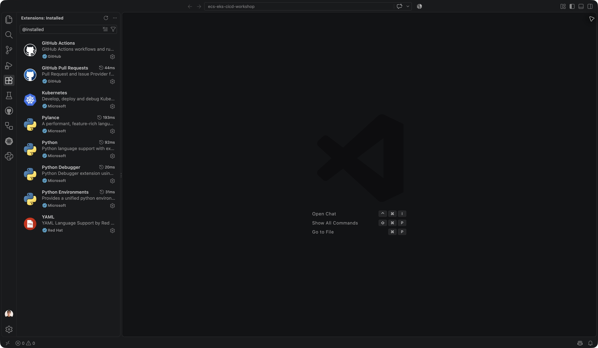

*Figure 2 GitHub and Kubernetes tooling installed in official VS Code. The top window bar is cropped from this capture.*

[Official GitHub Pull Requests extension](https://marketplace.visualstudio.com/items?itemName=GitHub.vscode-pull-request-github)

[Official GitHub Actions extension](https://marketplace.visualstudio.com/items?itemName=GitHub.vscode-github-actions)

[Kubernetes extension in Visual Studio Marketplace](https://marketplace.visualstudio.com/items?itemName=ms-kubernetes-tools.vscode-kubernetes-tools)

## 9 Read the source before running it

1. In VS Code Explorer open app/server.py. Find response. Notice how /healthz reports application health and /api/info reports release identity.

2. Open app/release.json. It holds the version number and a short release message.

3. Open app/index.html. This is the minimal browser interface. It reads the APIs when Refresh checks is selected.

4. Open tests/test_app.py. Read the four starter checks: health, intentionally unhealthy configuration, source identity and an unknown URL.

5. Open Dockerfile and Jenkinsfile. The first describes the packaged application; the second orders the delivery stages.

6. Open .vscode/tasks.json. Each menu task runs a supplied helper; it is not a different cloud service.

**What this step means**

A version such as 1.0.0 is a human label. A Git commit identifies the source. An image digest identifies the built container. Two pages can both say 2.0.0 and still run different code, so you will compare commit and digest as well.

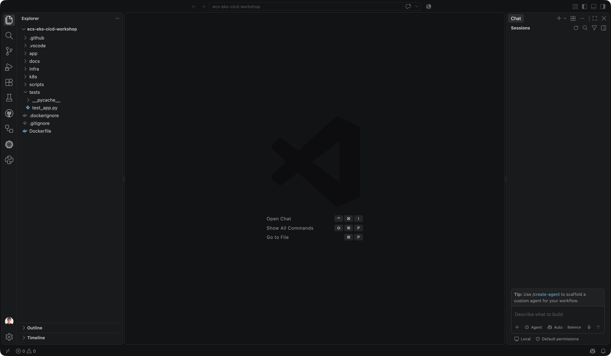

*Figure 3 The workshop project in VS Code Explorer.*

## 10 Start your Learner Lab

1. Sign in to AWS Academy and open the course Learner Lab.

2. Choose Start Lab. Wait until the lab indicates it is ready before opening AWS.

3. Choose AWS to open the console. Select US East N Virginia, us-east-1, in the region menu.

4. Check the remaining session time and budget. Leave enough time for asynchronous infrastructure creation.

5. Confirm the account has the existing LabRole, LabInstanceProfile, EKS cluster role and EKS node role required by this course. Role names may have lab-generated prefixes.

**Check before continuing**

The AWS console opens in your own Learner Lab account and the selected region is us-east-1. Course lab permissions vary; a missing EKS role is a prerequisite issue to resolve with the instructor.

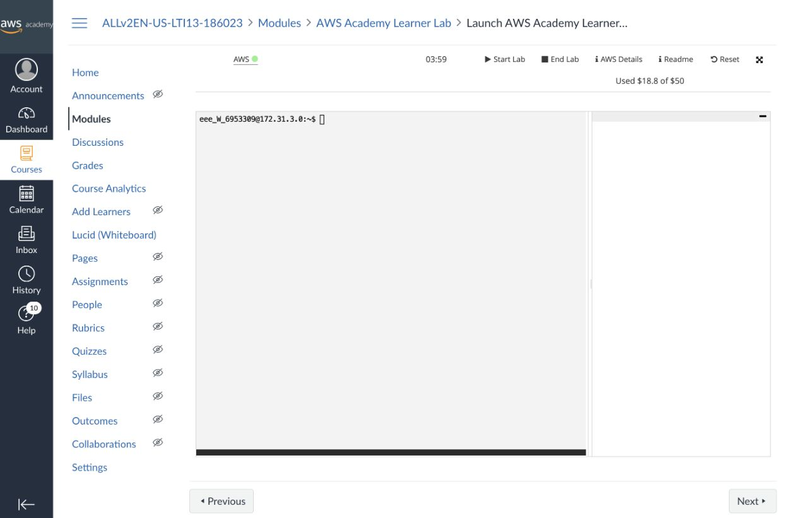

*Figure 4 The instructor Learner Lab ready state. Your account details and budget will differ.*

## 11 Create the first GitHub version

1. Open Source Control in VS Code and choose Initialize Repository if the starter is not yet a Git repository.

2. Make sure the initial branch is named main. If it is named something else, open Command Palette and choose Git Rename Branch, then enter main.

3. Review the changes. Ensure .lab, credentials, private keys and generated artifacts are excluded by .gitignore.

4. Enter Initial container workshop as the commit message and choose Commit. Review and confirm staging if prompted.

5. Choose Publish Branch or Publish to GitHub. Create your own private repository and record its HTTPS URL.

6. Open that repository in the browser and confirm your files and first commit appear on main.

**Check before continuing**

Your private GitHub repository exists, main contains the first commit, and no secret values appear in the files.

**If Git asks for your identity**

Git needs an author name and email before it can create a commit. In GitHub Settings → Emails you can find your GitHub-provided no-reply address. Set your name and that address in VS Code’s terminal using the two optional commands below, then retry Commit. These are initial workstation settings, not deployment commands.

`git config --global user.name "YOUR NAME" git config --global user.email "YOUR GITHUB NO REPLY EMAIL"`

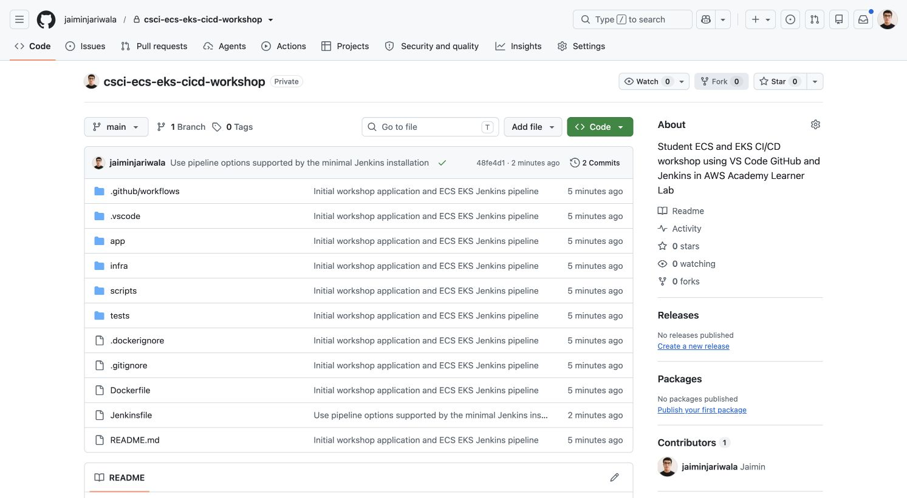

*Figure 5 The initial workshop repository and source files on GitHub.*

## 12 Run the first tests and understand CI

1. In VS Code’s top menu bar choose Terminal → Run Task… and select 4 Test application. Read the results and confirm that the four starter tests pass.

2. In GitHub open Actions. Select Application CI for the first commit.

3. Open the test job and inspect its completed steps. Wait for a green successful result before continuing.

**What this step means**

Local tests give fast feedback on your computer. GitHub Actions repeats the tests on another runner when a commit is pushed or a pull request changes. Jenkins later deploys the source; GitHub CI in this project does not have AWS deployment credentials.

**Check before continuing**

Four tests pass for version 1.0.0 and GitHub Actions reports success for the same commit you published.

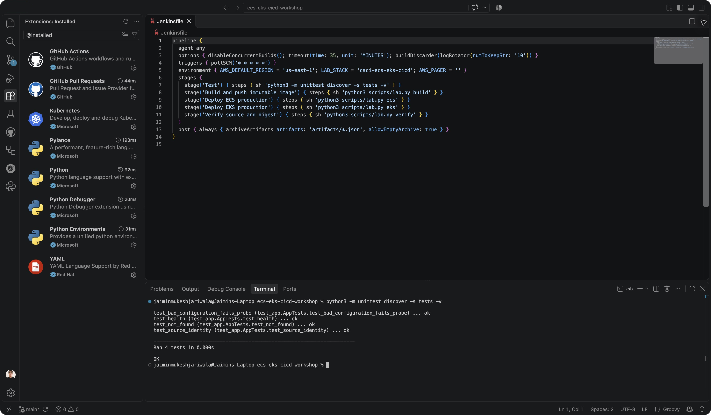

*Figure 6 The original baseline tests passed in VS Code.*

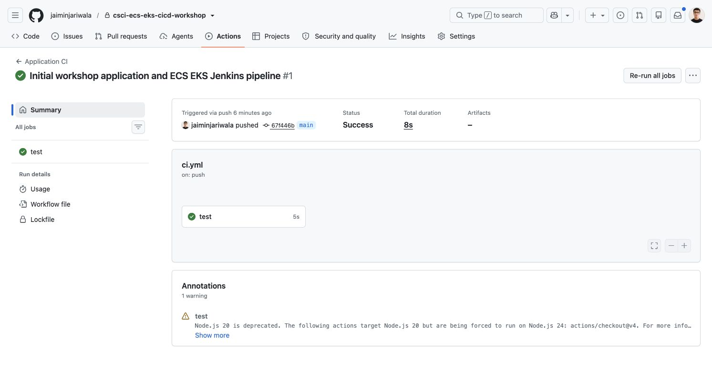

*Figure 7 A successful GitHub Actions test run for the initial source.*

## 13 Choose the network and existing roles

A VPC is the network boundary for the lab. A subnet is a section of that network in one Availability Zone. A region contains multiple separated Availability Zones. An ARN is the full AWS resource identifier; copy the entire role ARN rather than only its name. The instances need outbound internet access to download official images and packages; that does not mean the application needs public inbound access.

1. In AWS Console open VPC → Your VPCs. Find the default VPC and record its VPC ID.

2. Open Subnets and filter by that VPC. Choose two public subnets in different Availability Zones.

3. Inspect their route table association: a public subnet has an internet route to an internet gateway. Check its subnet settings for automatic public IPv4 assignment. Use an instructor-approved network rather than changing unrelated networking.

4. Open IAM → Roles. Search for LabEksClusterRole and copy the matching existing role ARN. Then find LabEksNodeRole and copy its ARN. Include any lab-generated name prefix.

5. Determine your workstation’s current public IPv4 address. Enter that address followed by /32 for the template. Use the public address your network presents to AWS, not a private Wi-Fi address such as 192.168.x.x.

**Check before continuing**

You have one VPC ID, two subnet IDs in different zones, two existing role ARNs, and your public IPv4 address with /32.

/32 means one IPv4 address. It limits access to the public Kubernetes API endpoint to your workstation address. Jenkins reaches the private endpoint inside the VPC. The template does not open public application or Jenkins inbound ports.

## 14 Create the workshop stack in CloudFormation

1. Open CloudFormation → Create stack → With new resources.

2. Choose Upload a template file and select infra/lab.yaml from your student-starter folder. Choose Next.

3. Enter csci-ecs-eks-cicd as the stack name. The supplied helpers expect this exact name.

4. Select the VPC and both subnets. Set WorkstationCidr to your public IPv4/32. Paste the existing EKS cluster and node role ARNs.

5. Keep KubernetesVersion at 1.35 and keep the supplied Amazon Linux 2023 image parameter. Continue through the stack options.

6. Review the resource and parameter summary. Submit the stack and open Events.

7. Wait for CREATE_COMPLETE. Refresh Events while AWS creates the EKS control plane and node group. Do not submit duplicate stacks while the first one is still creating.

8. Open Outputs and record JenkinsId, EcrUri, EcsCluster, EksCluster, LogGroup and AuditBucket.

**Check before continuing**

The stack is CREATE_COMPLETE. Its ECS cluster, EKS cluster, managed node group and Jenkins instance exist. The application service is created by Jenkins later, so an empty ECS cluster at this stage is expected.

The original initial infrastructure was created through automation. The photographed console workflow is a later audit bucket update. The parameter and completed stack screenshots below are genuine reference evidence; they are not presented as a complete recording of every initial creation click.

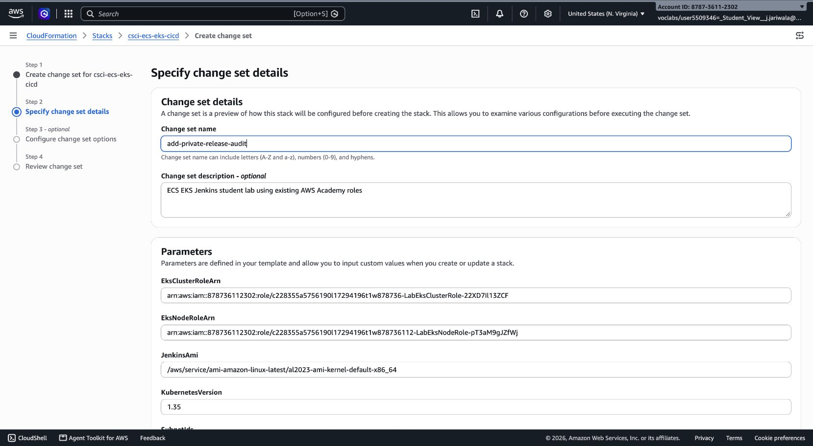

*Figure 8 CloudFormation parameters in the actual console update workflow.*

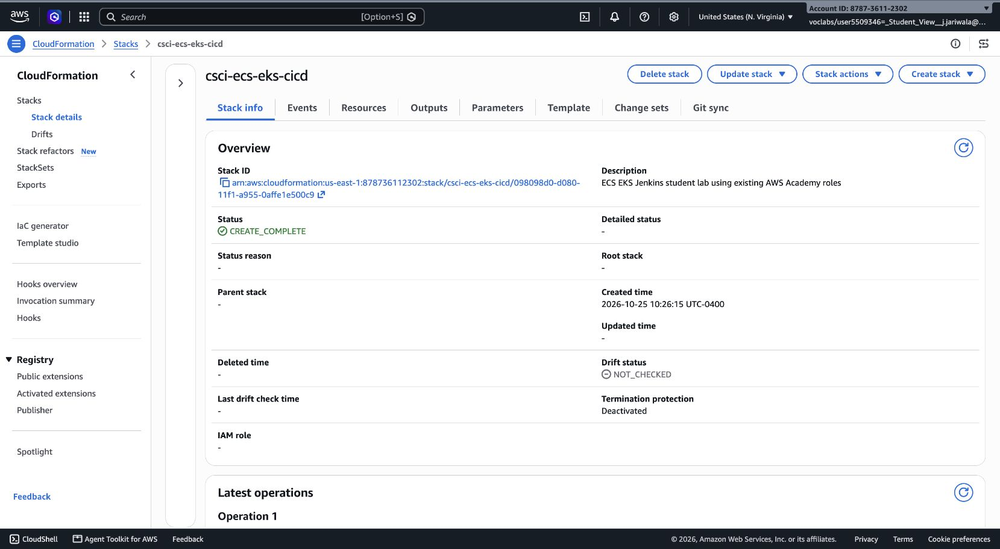

*Figure 9 The infrastructure stack reached CREATE_COMPLETE.*

## 15 Connect VS Code to your lab safely

1. Return to the Learner Lab page and open AWS Details → AWS CLI. Keep this panel off the projected screen if it displays credentials.

2. Task 0 has already created the .lab folder inside student-starter. In VS Code Explorer, create a file named credentials inside .lab, with no .txt extension.

3. Copy the complete temporary credential block into this file, including its profile header, access key, secret key and session token. Save. Do not copy these values into chat or the Word report.

4. Confirm Source Control does not list .lab/credentials. If it does, stop and fix .gitignore before publishing anything.

5. In the VS Code top menu bar choose Terminal → Run Task… and select 1 Prepare Kubernetes namespace. Wait for Workshop namespace is ready.

**What this step means**

Signing into the AWS browser console does not automatically sign the local AWS CLI into that account. The task helper reads the temporary credentials in .lab/credentials. The namespace task writes a private kubeconfig and creates namespace workshop. Jenkins receives edit access only in that namespace.

**Check before continuing**

The namespace task completes successfully and credentials remain outside Git. Refresh the temporary credential file whenever a new lab session provides new credentials.

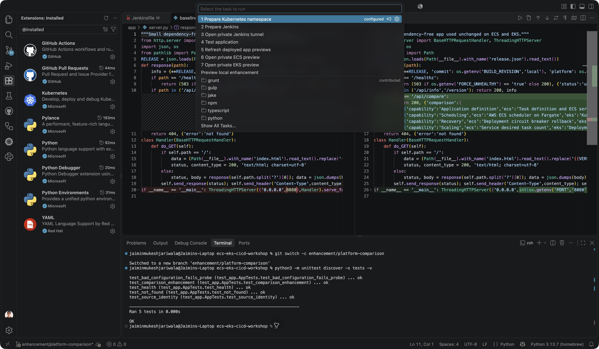

*Figure 10 The numbered VS Code task menu used throughout the lab.*

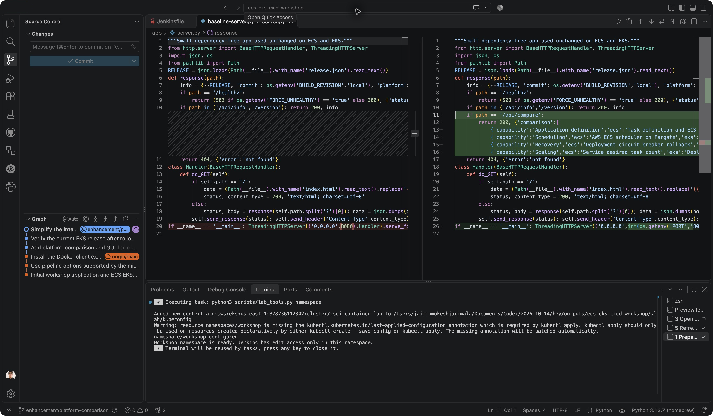

*Figure 11 The namespace task confirms that workshop is ready.*

## 16 Prepare Jenkins and its repository access

1. In the VS Code top menu bar choose Terminal → Run Task… and select 2 Prepare Jenkins.

2. When asked, paste your own private GitHub repository HTTPS URL. Wait for the Systems Manager setup command to complete.

3. Open .lab/github-readonly.pub in VS Code. This is the PUBLIC key generated for this dedicated Jenkins host.

4. In your GitHub repository open Settings → Deploy keys → Add deploy key. Give it a workshop label, paste only the public key and leave Allow write access unchecked. Save the key.

5. In AWS Console open Secrets Manager → csci-jenkins-workshop → Retrieve secret value. Privately note the generated username and password. Do not screenshot the value.

**What this step means**

Jenkins needs permission to read your private source. A repository deploy key gives that access without copying your personal GitHub password into Jenkins. The private key stays on the dedicated host. AWS API calls use the existing instance profile, not GitHub AWS secrets.

This teaching setup gives Jenkins control of Docker through the dedicated host’s Docker socket. Use only trusted workshop code and contributors. The host runs Jenkins inside an official container; this does not require Jenkins or Docker Desktop on your workstation.

**Check before continuing**

Setup succeeds, the read-only deploy key is registered on the correct repository, and you can retrieve the Jenkins login privately. An initial Git checkout can fail before the deploy key is added; add the key and start a new build.

## 17 Open Jenkins through the private tunnel

1. In the VS Code top menu bar choose Terminal → Run Task… and select 3 Open private Jenkins tunnel.

2. Keep this task terminal running. It connects local port 18080 to Jenkins port 8080 through Systems Manager.

3. Open http://127.0.0.1:18080 in your workstation browser.

4. Sign in using the generated Jenkins username and password from Secrets Manager.

5. Open the container-delivery pipeline job. If the page refuses the connection, inspect the task terminal before changing any AWS network rule.

**Check before continuing**

You can see Jenkins in the browser through the local URL. Closing the forwarding task stops browser access; it does not delete Jenkins or the application.

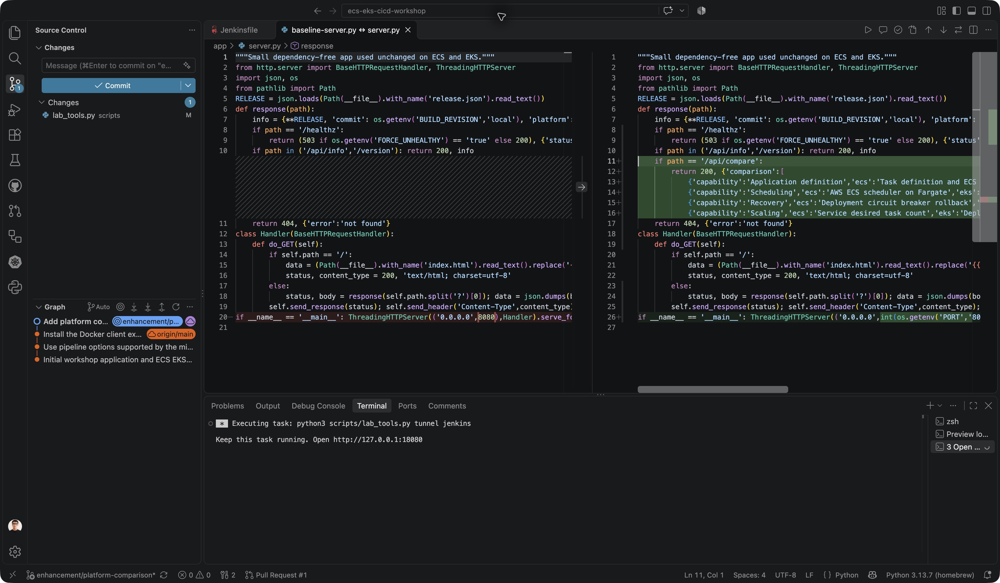

*Figure 12 The private Jenkins connection is opened from a VS Code task.*

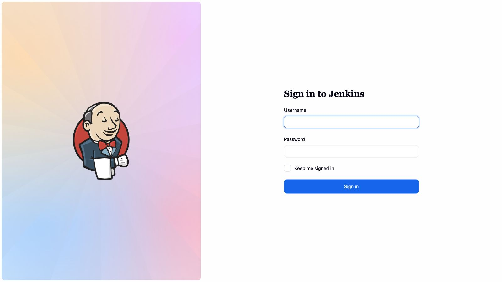

*Figure 13 The Jenkins sign-in page without credentials displayed.*

## 18 Build and deploy version 1

1. In container-delivery select Build with Parameters. Leave CLOUD_EXTENSION off for the core exercise.

2. Choose Build and open the new build number. Select Console Output to follow its stages.

3. Test runs the application checks. Build and push creates or reuses the image tagged with the Git commit and records its digest.

4. Deploy ECS production creates an ECS task definition and service. Deploy EKS production applies the Kubernetes Deployment and Service.

5. Verify source and digest checks both actual runtimes. Wait for SUCCESS before continuing.

6. Open Artifacts → verification.json and confirm PASS. Record the source commit and image digest for this run.

**What this step means**

The word production in the stage names refers to main in your lab. Both platforms use the same immutable image. The pipeline waits for the services to become healthy; do not interpret a build in progress as a failure or repeatedly queue more builds.

**Check before continuing**

Your version 1 build is SUCCESS and its verification report says PASS. The report identifies ECS and EKS and shows the same source commit for both.

The original baseline was verified in build 3. The final instructor pipeline was verified again in build 8. The revised starter uses the web interface; its revised presentation is checked locally, while the original baseline and final enhancement are supported by their recorded cloud executions.

*Figure 14 The final verified Jenkins job and its build-specific artifacts.*

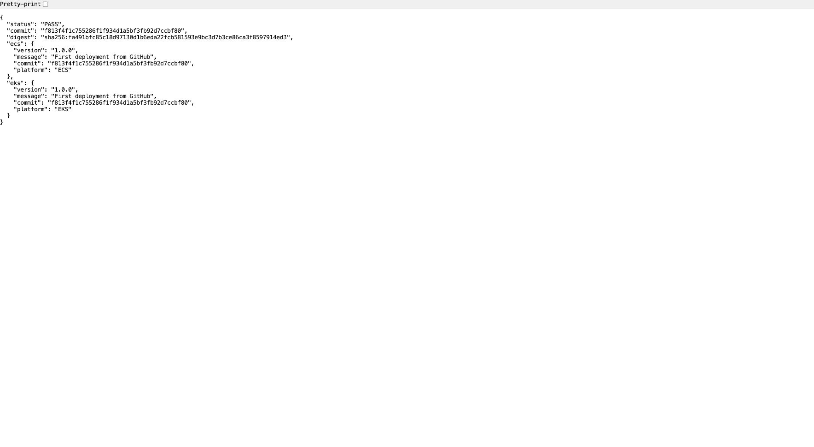

*Figure 15 The recorded baseline PASS report. Your new run will have its own commit and digest.*

## 19 Open the ECS and EKS applications

1. In the VS Code top menu bar choose Terminal → Run Task… and select 5 Refresh deployed app previews. Wait until it reports the ECS and EKS private preview responses.

2. Open Terminal → Run Task… again and select 6 Open private ECS preview. Keep this forwarding task running.

3. Repeat Terminal → Run Task… and select 7 Open private EKS preview in another task terminal. Keep it running as well.

4. Open http://127.0.0.1:18081 for ECS and http://127.0.0.1:18082 for EKS.

5. Read Runtime, Release, Source commit and Application health. Use Refresh checks to fetch the values again.

6. Choose View API response to inspect the live identity and health response. Compare the full source commit with your Jenkins verification artifact.

**Check before continuing**

Both pages are reachable and healthy. Runtime differs between ECS and EKS, while release and source commit match. After version 1 the comparison API is absent; after your version 2 enhancement the comparison rows appear.

The deployment screenshots below show the verified version 2 minimal interface. They are not relabeled as screenshots of a fresh version 1 run.

*Figure 16 The application on ECS after the enhancement.*

*Figure 17 The same application running on EKS.*

## 20 Create your enhancement branch locally

1. Return to VS Code. Confirm that your baseline source is committed and you are on main.

2. Click the branch name in the status bar and choose Create new branch. Enter enhancement/platform-comparison.

3. Open app/release.json and change version to 2.0.0. Set a short message describing the comparison feature. Save.

4. Open app/server.py and locate the final return 404 inside response. Add the new API block shown in the next section immediately before it.

5. Work inside your local student-starter repository. Do not directly edit main on GitHub; create a branch in VS Code and use a pull request to merge the change.

**What this step means**

The branch keeps your in-progress enhancement separate from main. Your local changes do not affect the running cloud services until you commit, publish, merge and Jenkins deploys the new revision.

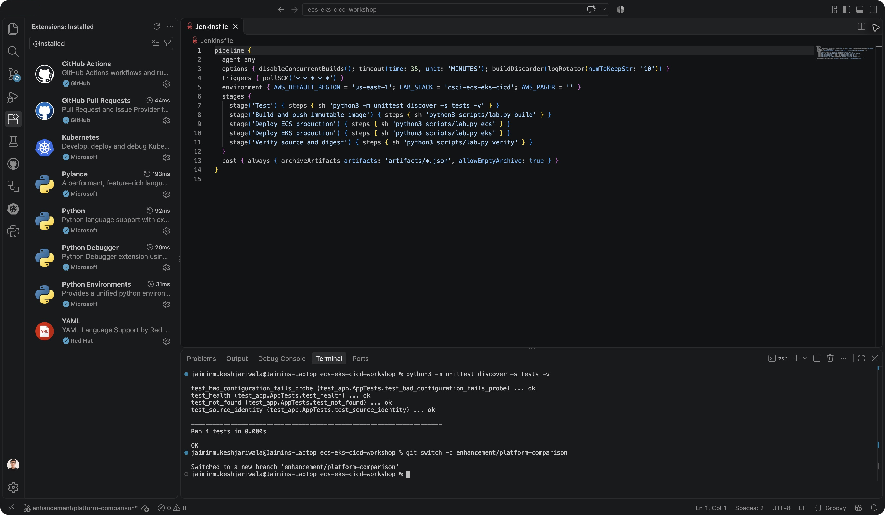

*Figure 18 A local enhancement branch in VS Code. The task menu is the preferred way to run checks.*

## 21 Implement and test the comparison feature

**Add the API**

Inside response in app/server.py, insert this block before the final not found return. The indentation is significant in Python. It creates a real endpoint consumed by the supplied interface.

`if path == '/api/compare': return 200, {'comparison':[ {'capability':'Application definition', 'ecs':'Task definition and ECS service', 'eks':'Kubernetes Deployment and Service'}, {'capability':'Scheduling', 'ecs':'AWS ECS scheduler on Fargate', 'eks':'Kubernetes scheduler on managed EC2 nodes'}, {'capability':'Recovery', 'ecs':'Deployment circuit breaker rollback', 'eks':'Readiness probes and explicit rollout undo'}, {'capability':'Scaling', 'ecs':'Service desired task count', 'eks':'Deployment replica count'}]}`

**Add a test**

Inside class AppTests in tests/test_app.py, add this method. It checks the new endpoint and ensures that both sides of each comparison contain text.

`def test_comparison_enhancement(self): status, data = app.response('/api/compare') self.assertEqual(status, 200) self.assertEqual(len(data['comparison']), 4) self.assertTrue(all(row['ecs'] and row['eks'] for row in data['comparison']))`

1. Save the server and test files. The starter already contains the web interface; it will display the comparison rows when this endpoint exists.

2. In the VS Code top menu bar choose Terminal → Run Task… and select 4 Test application. Require all five tests to pass.

3. Choose Terminal → Run Task… and select Preview local enhancement. Open http://127.0.0.1:18083. Check that the comparison rows appear and the page reports local as the runtime.

4. Select Refresh checks and View API response. Confirm that the new release message is displayed.

5. If adding your own fifth comparison row, update the expected row count in the test.

**Check before continuing**

Five tests pass. The local preview shows version 2.0.0 and comparison rows. This proves local behavior; it does not yet prove cloud deployment.

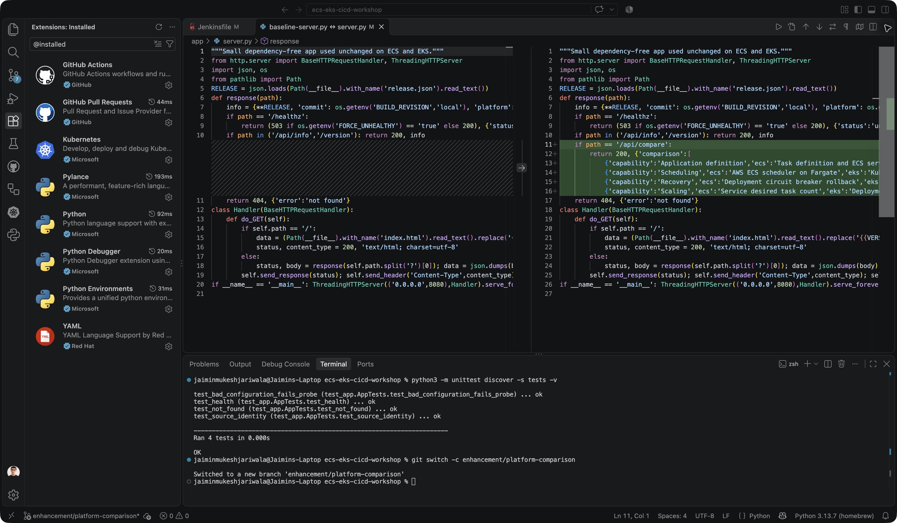

*Figure 19 Review the API change against the baseline source.*

## 22 Commit publish and review your changes

1. Open Source Control in VS Code. Select each changed file to read its diff. Confirm that only intended application and test changes are included.

2. Enter a meaningful message such as Add ECS and EKS comparison API. Choose Commit and review the staging prompt if one appears.

3. Choose Publish Branch or Sync Changes to send the branch to GitHub.

4. In GitHub choose Compare and pull request for the published branch. Set the base to main and compare to your enhancement branch.

5. Describe what changed, why a student can observe it, and how you tested it. Create the pull request.

6. Open Files changed. Review the API, version and test changes. Wait for all CI checks to pass.

**What this step means**

A commit saves a local revision. Publishing sends it to GitHub. A pull request allows review before changing main. CI checks the proposed source independently; it does not replace reading the diff.

**Check before continuing**

The pull request targets main, its diff contains no credentials, and every required CI check is successful.

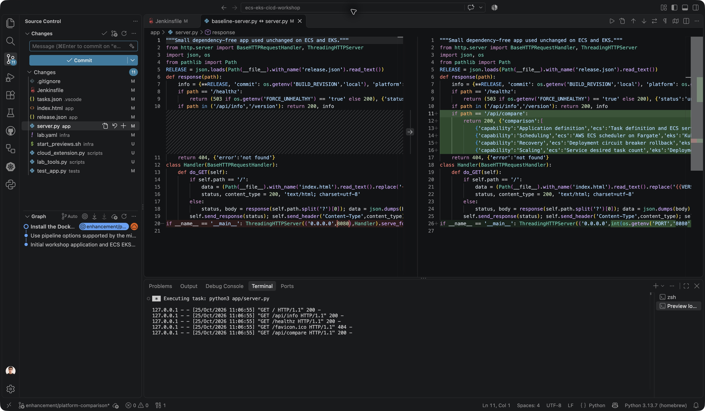

*Figure 20 Source Control shows local changes for review.*

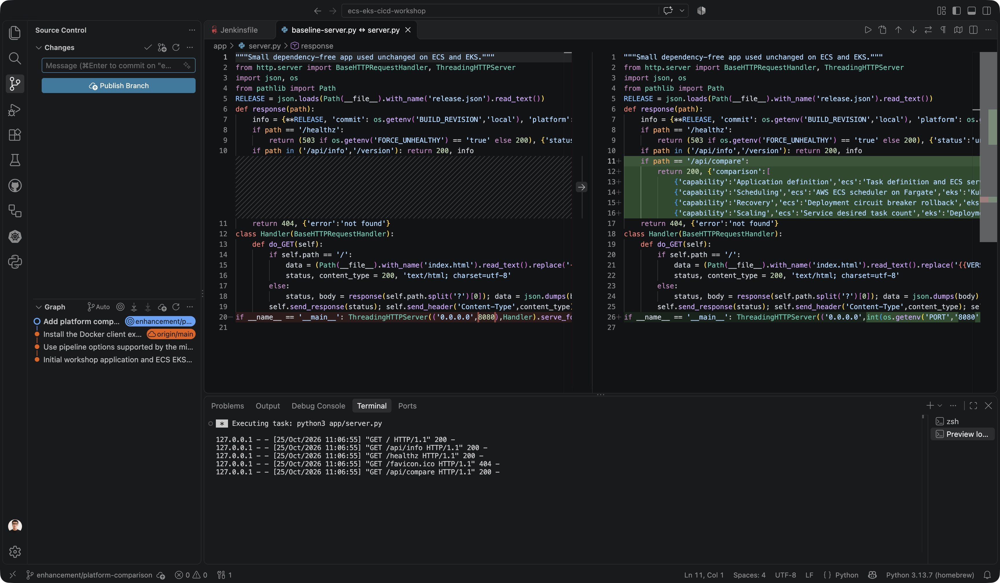

*Figure 21 Publish the enhancement branch through the VS Code interface.*

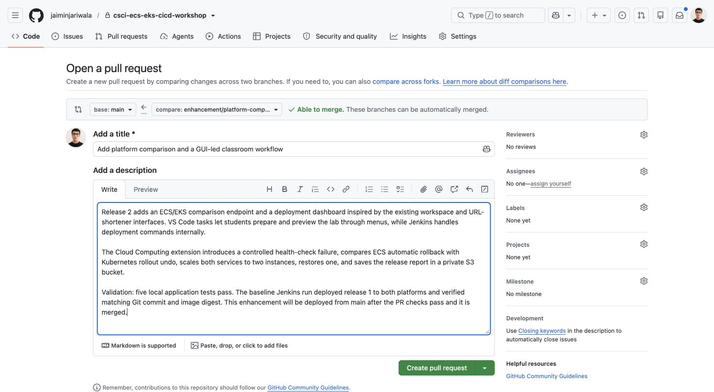

*Figure 22 The pull request form explains the enhancement and its validation.*

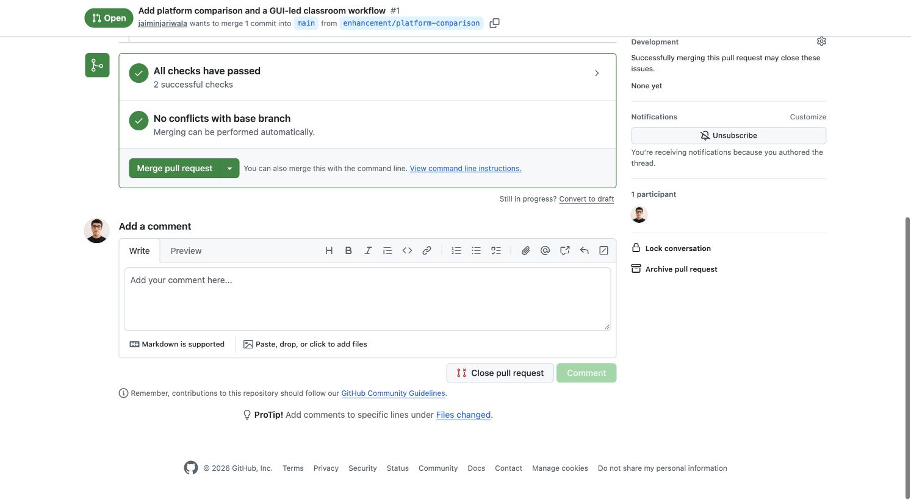

*Figure 23 The enhancement CI checks passed before merging.*

## 23 Merge to production and verify the enhancement

1. On the pull request choose Merge pull request and then Confirm merge. This updates main in the teaching repository.

2. Open Jenkins. Its SCM polling checks main approximately once per minute. Find the build started for the merge.

3. Follow the console stages until SUCCESS. The merge commit can differ from the feature branch commit; record the revision Jenkins actually checked out.

4. In the VS Code top menu bar choose Terminal → Run Task… and select 5 Refresh deployed app previews after the deployment, since task IPs and pod connections can change. Repeat Terminal → Run Task… to reopen tasks 6 and 7 if their tunnels have expired.

5. Refresh both browser pages. Confirm version 2.0.0 and the comparison feature.

6. Open the successful build verification.json. Compare its commit with both applications and confirm the digest checks passed.

**Check before continuing**

Both cloud runtimes serve the merged enhancement. The final instructor run was build 8, commit 297992472c887759a8518d1a07e3c8cde00a97f7, with source and image identity PASS.

The development history includes a corrected verification check that initially selected a terminating old EKS pod. The final code excludes terminating pods and requires the expected image and source annotation. The final Jenkins pipeline also clears previous JSON reports before each run so an optional extension report cannot carry into a different build.

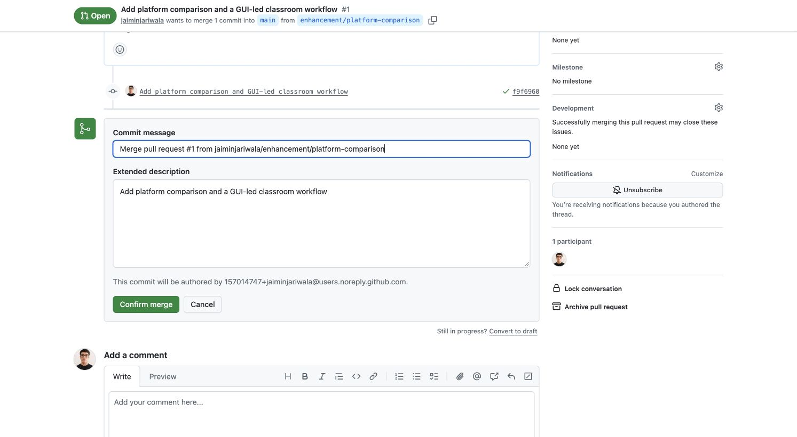

*Figure 24 Confirm the pull request merge into the lab production branch.*

*Figure 25 The enhancement pull request successfully merged.*

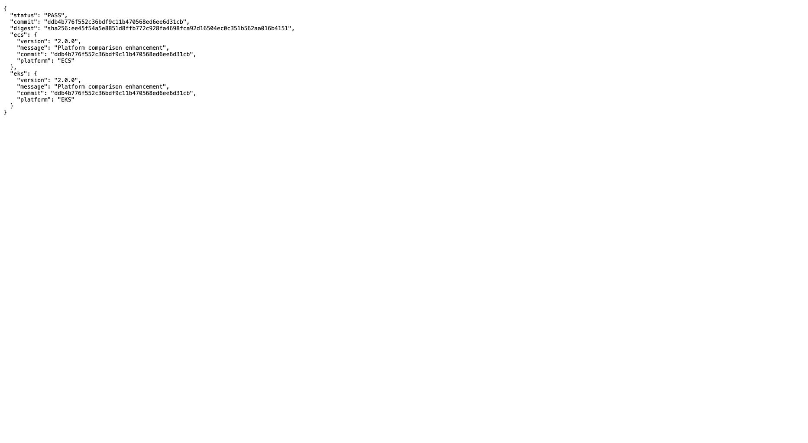

*Figure 26 A genuine enhancement verification report with matching identities on both platforms.*

## 24 Inspect ECS and EKS in AWS Console

1. Open ECS → Clusters → csci-container-lab → Services → container-demo.

2. Open Tasks to inspect running containers. Open the task definition to see the image, port, environment and health check.

3. Open Deployments and Events to observe rolling updates and failures. A temporary second task during a rolling update does not mean desired count was permanently changed.

4. Open EKS → csci-container-lab. Check its version and managed node group in Compute.

5. Open Resources → Deployments → container-demo in namespace workshop. Inspect pods, image and conditions.

6. Relate the ECS service and task definition to the Kubernetes Deployment, Service and pods. Write what each platform keeps running when one container fails.

**Check before continuing**

You can identify the same application in each console without relying only on the web page.

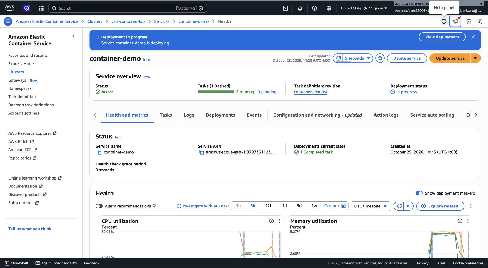

*Figure 27 The ECS service during an actual rolling deployment.*

*Figure 28 The Kubernetes Deployment with its pods and rollout conditions.*

## 25 Run the Cloud Computing extension

This optional extension deliberately introduces an unhealthy application configuration into the disposable workshop services. Do it after the core deployment works. The verified run took about 12 minutes, so allow extra time beyond the short presentation.

1. In Jenkins open container-delivery → Build with Parameters.

2. Enable CLOUD_EXTENSION and choose Build. Open the new build console.

3. Observe the EKS stage: an unhealthy new pod fails readiness, the rollout exceeds its progress deadline, and the script explicitly undoes the failed rollout. Kubernetes does not automatically undo this Deployment in the exercise.

4. Observe ECS: new tasks fail the container health check. The configured deployment circuit breaker detects failure and restores the previous task definition.

5. Observe scaling: the script requests two ECS tasks and two Kubernetes replicas, verifies both counts, then restores one copy on each platform.

6. Wait for final identity verification and SUCCESS. Open cloud-extension.json in that build’s artifacts.

7. In AWS Console open S3, find the stack AuditBucket output, and open releases → the tested commit → cloud-extension.json. Inspect its properties and encryption.

**Check before continuing**

The report shows the failed EKS rollout, explicit undo, ECS automatic rollback, two running tasks and two ready replicas, and final health PASS. The private S3 report exists. This is correctness evidence for a small experiment, not a performance benchmark.

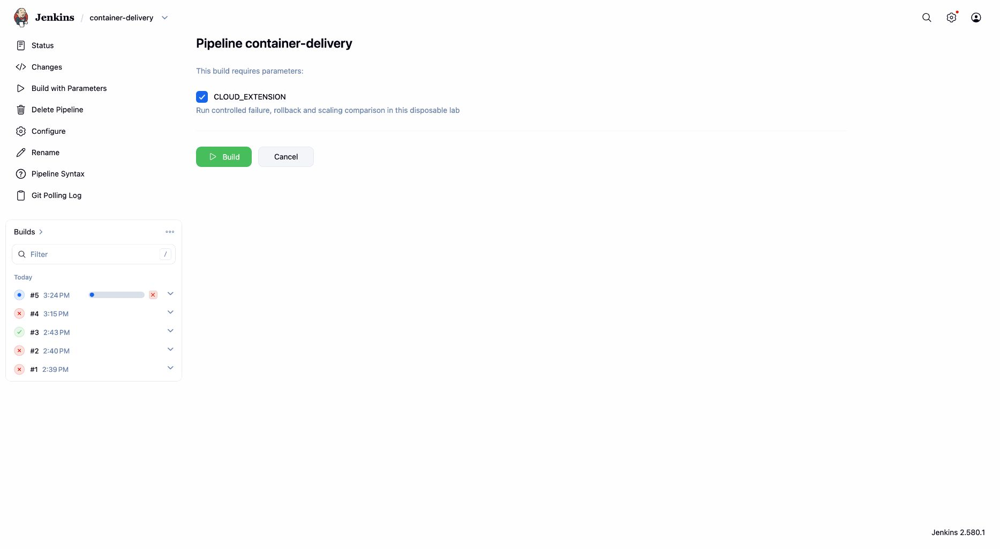

*Figure 29 Enable the Cloud Computing extension using the Jenkins parameter.*

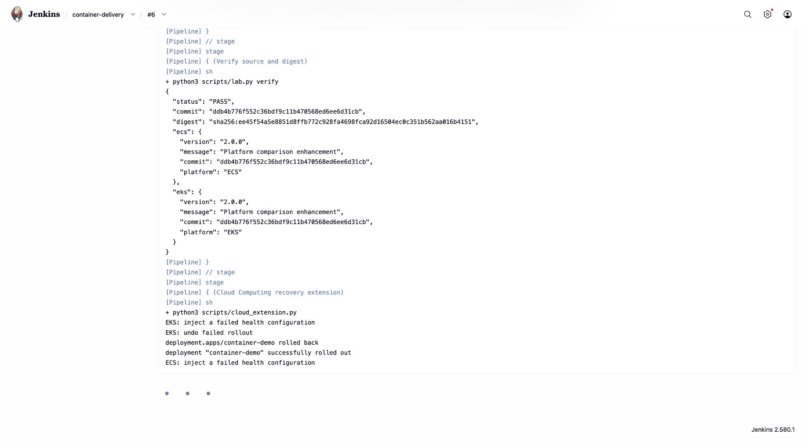

*Figure 30 The executed EKS rollback restored the deployment.*

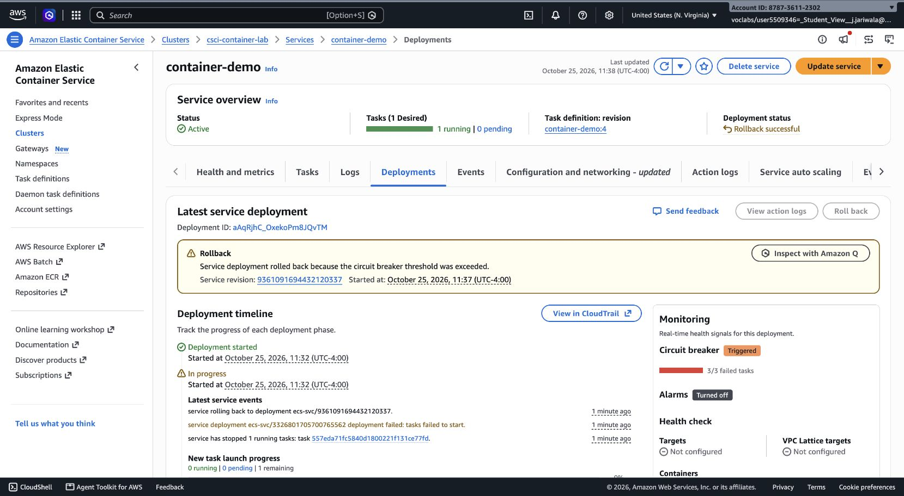

*Figure 31 ECS reports automatic rollback after three failed tasks.*

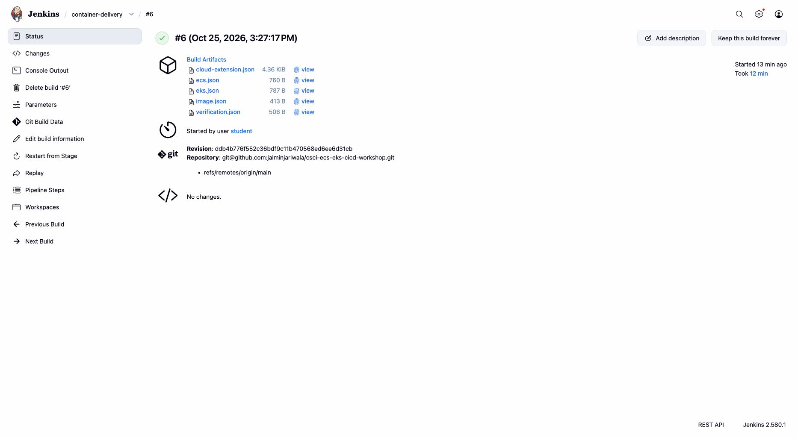

*Figure 32 Build 6 completed the recovery and scaling extension successfully.*

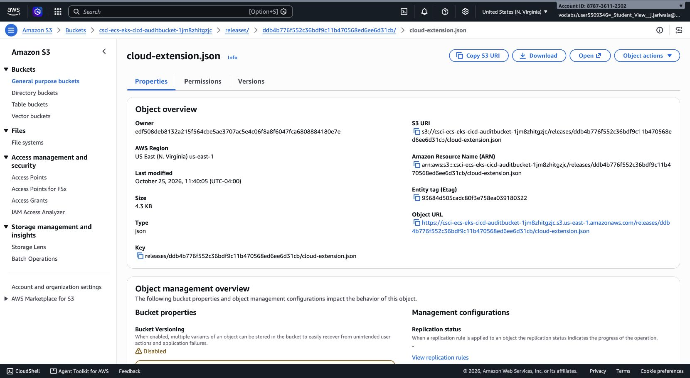

*Figure 33 The recorded recovery report in the private S3 bucket.*

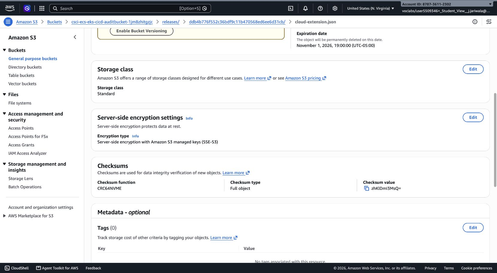

*Figure 34 The report is encrypted with Amazon S3 managed keys.*

## 26 Write your platform comparison

The professor asked students to compare ECS and EKS. This table summarizes the platform differences shown in the workshop.

| **Question** | **ECS Fargate in this lab** | **EKS in this lab** |
| --- | --- | --- |
| How is the app defined | Task definition and service | Deployment and Service |
| Who manages worker compute | Fargate manages task compute | You configure a managed EC2 node group |
| How is desired count expressed | Desired tasks on the service | Replicas on the Deployment |
| What recovered the failed update | Configured circuit breaker rollback | Explicit rollout undo after a failed rollout |
| What is common | Same source image and Jenkins pipeline | Same source image and Jenkins pipeline |

## 27 Troubleshoot by checking the right layer

| **Symptom** | **First action** |
| --- | --- |
| Task command is not found | Install the missing tool using its official link, check PATH and restart VS Code. |
| Python task fails on Windows | Use the package Windows task override with python and make sure Python is on PATH. |
| ExpiredToken or invalid credentials | Start or resume Learner Lab and refresh all temporary credential fields in .lab/credentials. |
| Access denied on EKS or IAM | Confirm the course lab provides the required existing roles and permissions. Do not substitute administrator access. |
| Jenkins Git checkout fails | Verify repository URL and its read-only deploy key. Then start a new build. |
| Localhost refuses connection | Keep the correct SSM task running. Restart its tunnel if expired; do not open public ports. |
| App preview is stale after deployment | Run task 5 again, then refresh or reopen the appropriate tunnel. |
| Jenkins verification fails | Compare actual source and digest, inspect the first failing stage, and confirm rollout completed. |
| CloudFormation creation fails | Read the first failed resource event. Resolve the specific role, network, quota or resource-name conflict before retrying. |

Read the first useful error rather than repeatedly clicking Build. Some initial setup and rollout failures remain visible in the instructor history. The final successful executions and final source contain their corrections.

## 28 Clean up the workshop resources

Save your report and screenshots before deleting lab resources. A stopped Learner Lab session is not the same as complete resource cleanup. EKS control plane charges can continue while worker instances are stopped.

1. Confirm that you are acting only on this ECS EKS workshop and have saved its evidence. Keep earlier PostgreSQL and Elasticsearch resources separate.

2. In ECS set the workshop service desired tasks to zero. Once stopped, delete that service so the cluster can be removed.

3. In S3 empty only the workshop audit bucket if you intend to delete its CloudFormation stack. In ECR remove only the workshop images if repository deletion requires it. These actions remove the stored lab evidence and images, so preserve them first.

4. Delete the csci-ecs-eks-cicd CloudFormation stack. Let it remove its managed node group, EKS cluster, EC2 host and other managed resources. Review Events until DELETE_COMPLETE and resolve any nonempty resource error.

5. Delete the separately created Jenkins secret using the normal recovery window when it is no longer needed. Remove the workshop repository deploy key.

6. For a fresh build in the same account, confirm old fixed-name resources are gone before returning to the starter. If using another lab account, use its own roles, subnets and current credentials.

**Scope of the recorded verification**

The verified instructor run used AWS Academy in us-east-1. Baseline build 3 and enhancement build 5 passed. Build 6 passed recovery and scaling and saved the encrypted S3 report. Build 7 delivered the minimal interface; build 8 reverified delivery after fixing artifact carryover. The revised starter presentation and new prerequisite helper are checked locally. The combined student setup wrapper has not been executed in a second clean account. Check your course permissions before class.

Screenshots show the recorded instructor execution. Results from your own run will have different account and resource values.

## 29 Official downloads and learning references

The links in the download section open the official vendor pages or vendor-hosted installers. If an installer name changes, use its official instructions rather than a third-party mirror.

[Amazon ECS Immersion Day workshop](https://catalog.workshops.aws/ecs-immersion-day/en-US)

[Amazon EKS Workshop fundamentals](https://eksworkshop.com/docs/fundamentals/)

[Docker containers](https://docs.docker.com/get-started/docker-concepts/the-basics/what-is-a-container/)

[Amazon ECR concepts](https://docs.aws.amazon.com/AmazonECR/latest/userguide/what-is-ecr.html)

[Systems Manager Session Manager](https://docs.aws.amazon.com/systems-manager/latest/userguide/session-manager.html)

[Terraform overview](https://developer.hashicorp.com/terraform/intro)

[eksctl overview](https://docs.aws.amazon.com/eks/latest/eksctl/what-is-eksctl.html)

[Kubernetes learning environments](https://kubernetes.io/docs/setup/learning-environment/)

[Amazon ECS concepts](https://docs.aws.amazon.com/AmazonECS/latest/developerguide/Welcome.html)

[Amazon EKS concepts](https://docs.aws.amazon.com/eks/latest/userguide/what-is-eks.html)

[EKS access entries](https://docs.aws.amazon.com/eks/latest/userguide/access-entries.html)

[Jenkins pipeline documentation](https://www.jenkins.io/doc/book/pipeline/jenkinsfile/)

[VS Code GitHub workflow](https://code.visualstudio.com/docs/sourcecontrol/github)

This independent teaching adaptation combines the container service and Kubernetes fundamentals with VS Code and Jenkins, using the existing Learner Lab roles and a small application rather than the full infrastructure of the source workshops.

## Repository layout

| Path | Purpose |
| --- | --- |
| `app/` | Python web server, browser interface, and release metadata. |
| `tests/` | Application behavior tests. |
| `infra/lab.yaml` | CloudFormation template for the workshop AWS resources. |
| `infra/` | Jenkins host setup and private application preview helpers. |
| `Jenkinsfile` | Jenkins pipeline stages for testing, image build, deployment, and verification. |
| `scripts/` | VS Code task helpers for workstation checks, lab connections, and deployment observations. |
| `docs/images/workshop-guide/` | Screenshots embedded throughout this README. |

## Recorded release verification

In the recorded instructor run, Jenkins build 8 passed verification for ECS and EKS. Both deployments reported source commit `297992472c887759a8518d1a07e3c8cde00a97f7` and image digest `sha256:6f93f9f29efd743534b842846ea8e83605eaf45d00e6c0ae4cc3bd25c49c91ba`. Build 6 completed the separate Cloud Computing recovery and scaling extension and saved its encrypted S3 report. Your own account, resource IDs, commit hashes, image digest, and build numbers will differ.
