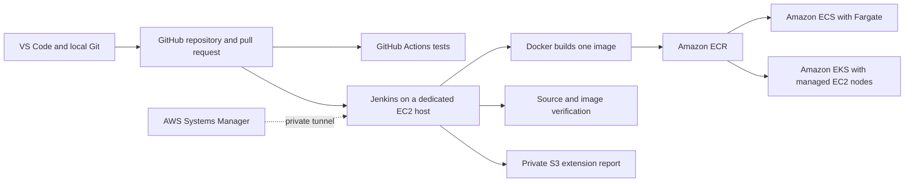
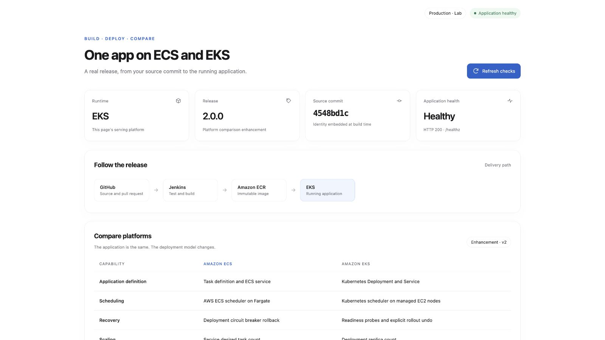
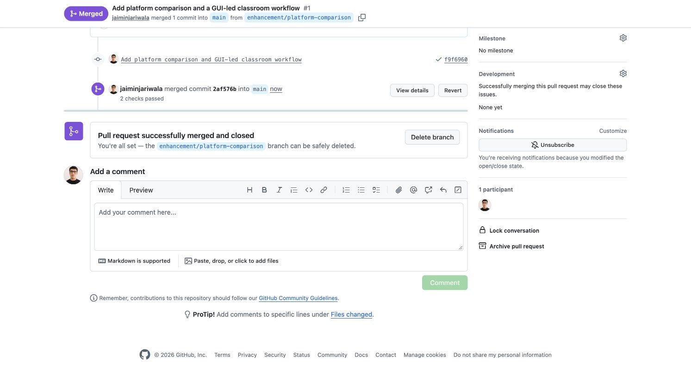
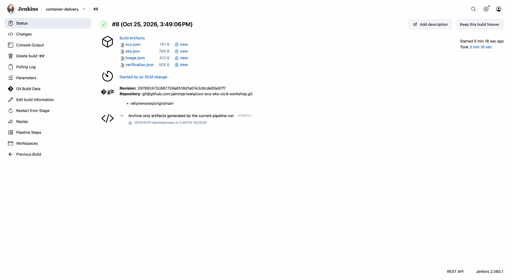
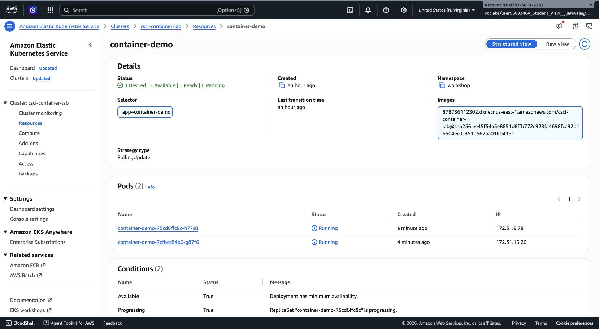

# ECS and EKS container delivery workshop

This repository supports a hands-on workshop I conduct in **Cloud Computing** and **Database Management Systems II**. It demonstrates how one small web application can be developed in Visual Studio Code, reviewed through GitHub, built by Jenkins, and deployed to both Amazon ECS and Amazon EKS.

The project makes the delivery process visible end to end: source code becomes a container image, the image is stored in Amazon ECR, and both platforms run the same verified image. The Cloud Computing extension also demonstrates recovery from an unhealthy release, scaling, and a private report in Amazon S3.

## What the workshop demonstrates

- **GitHub first:** create a repository, commit the starter application, and use GitHub Actions to run its tests.
- **A local enhancement:** create a branch in VS Code, add an ECS and EKS comparison API, run its tests, and review the change in a pull request.
- **Automated delivery:** after the change is merged into `main`, Jenkins tests the source, builds a Docker image, pushes it to ECR, and deploys it to ECS and EKS.
- **Platform comparison:** ECS runs the application as a Fargate service. EKS runs it in Kubernetes pods managed by a Deployment on an EC2 node group.
- **Cloud Computing extension:** observe ECS circuit-breaker recovery and Kubernetes rollout undo, scale both platforms, and save a private encrypted JSON report in S3.

## How the pieces fit together

CloudFormation creates the workshop infrastructure from `infra/lab.yaml`. GitHub stores source and reviews changes. Jenkins runs on the EC2 host and uses that host’s Docker Engine to build the application image. ECR stores the image; it does not store the source repository.

The Jenkins dashboard is served by Jenkins running in a Docker container on the EC2 host. Docker runs Jenkins and provides the image-building engine; it is not the dashboard application. AWS Systems Manager Session Manager carries a private tunnel from the local browser to the Jenkins page and the application previews, without opening public web ports for those services.

ECS and EKS receive the same image. ECS uses an ECS task definition and service; EKS uses a Kubernetes Deployment and Service. The Jenkins verification checks the deployed source commit and image digest on both platforms, so the comparison is based on the actual releases rather than page appearance alone.

## Recorded workshop execution

The screenshots below come from the instructor’s recorded workshop execution. Your own AWS account, resource IDs, commit hashes, and build numbers will differ.

### The same application on ECS and EKS

Both applications display the release information and platform identity from the running application.

| Amazon ECS | Amazon EKS |
| --- | --- |
|  |  |

### GitHub review and Jenkins delivery

The enhancement is reviewed and merged through a GitHub pull request. Jenkins then runs the delivery pipeline and records its verification artifacts.

### Inspecting the AWS deployments

These console views show the ECS service and Kubernetes Deployment after the application was deployed.

| ECS service | Kubernetes Deployment |
| --- | --- |
|  |  |

The Cloud Computing extension places its encrypted recovery report in the private S3 bucket created for this workshop.

## Repository layout

| Path | Purpose |
| --- | --- |
| `app/` | Python web server, browser interface, and release metadata. |
| `tests/` | Application behavior tests. |
| `infra/lab.yaml` | CloudFormation template for the workshop AWS resources. |
| `infra/` | Jenkins host setup and private application preview helpers. |
| `Jenkinsfile` | Jenkins pipeline stages for testing, image build, deployment, and verification. |
| `scripts/` | VS Code task helpers for checking tools, connecting to the lab, and observing deployments. |
| `docs/images/` | Screenshots embedded in this README. |

## Release verification

In the recorded instructor run, Jenkins build 8 completed with status `PASS` for ECS and EKS. Both deployments reported the same source commit, `297992472c887759a8518d1a07e3c8cde00a97f7`, and image digest, `sha256:6f93f9f29efd743534b842846ea8e83605eaf45d00e6c0ae4cc3bd25c49c91ba`.

The separate Cloud Computing recovery and scaling exercise completed in build 6. It recorded an EKS failed rollout followed by an explicit undo, ECS automatic circuit-breaker rollback, two running application copies on each platform during the scaling check, restoration to one copy, and a final health and identity check. Its report is separate from the final build 8 verification report.

## Main technologies

- [Amazon ECS](https://docs.aws.amazon.com/AmazonECS/latest/developerguide/Welcome.html) and [Amazon EKS](https://docs.aws.amazon.com/eks/latest/userguide/what-is-eks.html)
- [Amazon ECR](https://docs.aws.amazon.com/AmazonECR/latest/userguide/what-is-ecr.html) and [AWS CloudFormation](https://docs.aws.amazon.com/AWSCloudFormation/latest/UserGuide/Welcome.html)
- [Jenkins Pipeline](https://www.jenkins.io/doc/book/pipeline/jenkinsfile/) and [GitHub Actions](https://docs.github.com/actions)
- [AWS Systems Manager Session Manager](https://docs.aws.amazon.com/systems-manager/latest/userguide/session-manager.html)
- [Visual Studio Code GitHub workflow](https://code.visualstudio.com/docs/sourcecontrol/github)
